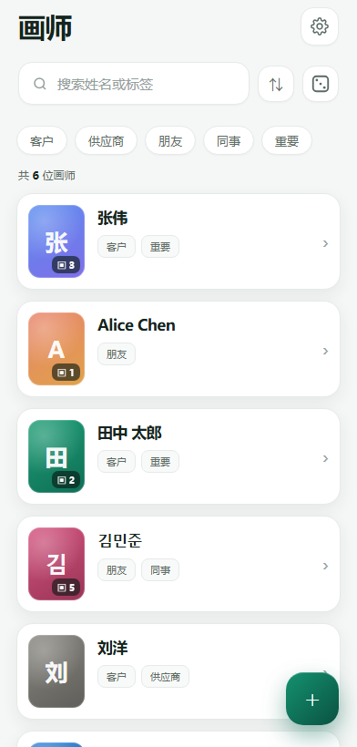
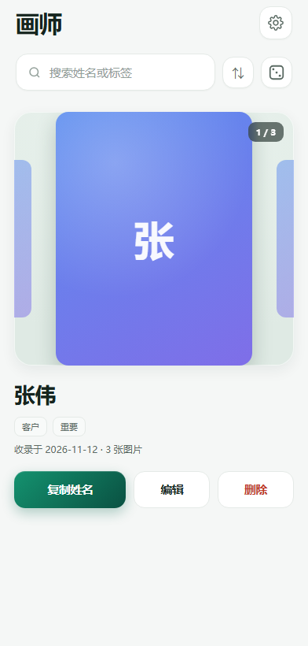
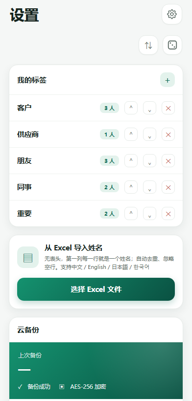

# 画师册（namebook）

记录漫画家 / 插画师名字的 Android 工具。本地存储，可选坚果云加密备份。Flutter + Dart 编写。

## 应用截图

| 画师列表 | 画师详情 |
| :---: | :---: |
|  |  |



## 功能

姓名（中/英/日/韩）· 标签 · 图片 · Excel 导入 · 搜索筛选排序 · 随机浏览 · 坚果云 WebDAV + AES-256 加密备份。

## 构建

```bash
flutter pub get
flutter build apk --release
```

首次构建需生成 `android/local.properties` 指向本机 Android SDK（Android Studio 会自动生成）。该文件含本机路径，已加入 `.gitignore`。

## 坚果云备份

设置页填：服务器 `https://dav.jianguoyun.com/dav/`、坚果云邮箱、第三方应用密码（非登录密码）、备份路径。密码派生密钥加密，丢失无法恢复。

## 下载

[Releases](https://github.com/Pluto-Sky23/namebook/releases) 有各版本 APK。当前 v1.7.8。

升级版本需同步改 `pubspec.yaml` 的 `version` 和 `lib/pages/settings_page.dart` 的 `appVersion` 常量。
